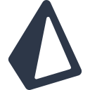

  

# Overview-Yerko-Barrera-Noviembre-2026

**Ingeniero en Computación e Informática · Licenciado en Ingeniería · Full Stack Developer**

Fundador de **YB Veltrix Solutions** · Chile

Diseño y desarrollo aplicaciones web, APIs y productos SaaS. Trabajo con **React, Next.js, TypeScript, NestJS y PostgreSQL** para llevar los proyectos desde los requerimientos hasta el despliegue.

[◆ Portafolio](https://veltrix.bpyerko.workers.dev/) &nbsp;·&nbsp; [◆ LinkedIn](https://www.linkedin.com/in/yerko-andr%C3%A9s-barrera-pantoja-a82821123/) &nbsp;·&nbsp; [◆ Contacto](https://veltrix.bpyerko.workers.dev/contacto)

## Stack tecnológico

**Frontend**

 **React** &nbsp; · &nbsp;  **Next.js** &nbsp; · &nbsp;  **TypeScript** &nbsp; · &nbsp;  **Angular** &nbsp; · &nbsp;  **Tailwind CSS**

**Backend**

 **Node.js** &nbsp; · &nbsp;  **NestJS**

**Datos**

 **PostgreSQL** &nbsp; · &nbsp;  **MongoDB** &nbsp; · &nbsp;  **Prisma ORM**

**DevOps y pruebas**

 **Docker** &nbsp; · &nbsp;  **GitHub Actions** &nbsp; · &nbsp;  **Jest** &nbsp; · &nbsp;  **Playwright**

**Nube**

 **Cloudflare** &nbsp; · &nbsp;  **Netlify**

## Proyectos seleccionados

| Proyecto | Enfoque |
| --- | --- |
| [Portafolio profesional](https://github.com/koyarxs/Project-06-Portafolio-Noviembre-2026) | Sitio Full Stack y presentación del trabajo de YB Veltrix Solutions. |
| [Zenvik](https://github.com/koyarxs/Project-05-Zenvik-Octubre-2026) | Interfaces web y servicios de backend con Next.js y Django REST. |
| [FraudShield](https://github.com/koyarxs/Project-01-FraudShield-Septiembre-2026) | MVP académico para clasificar riesgo con datos simulados. Sus resultados indican riesgo y no confirman fraude. |
| [Pawly](https://github.com/koyarxs/Project-03-Pawly-Octubre-2026) | Proyecto en etapa inicial con frontend en Next.js y evolución Full Stack planificada. |

## Actividad en GitHub

En GitHub desde junio de 2019 · corte al **23 de noviembre de 2026**.

**Commits** cuenta los cambios atribuidos a @koyarxs en las ramas predeterminadas de sus repositorios públicos, sin contar dos veces un mismo SHA. **Contribuciones visibles** suma el calendario público de GitHub e incluye otros tipos de actividad. Cada columna mide un conjunto distinto.

| Año | Commits públicos | Contribuciones visibles |
| --- | ---: | ---: |
| 2026 | 84 | 111 |
| 2025 | 15 | 18 |
| 2024 | 0 | 0 |
| 2023 | 0 | 0 |
| 2022 | 0 | 0 |
| 2021 | 0 | 0 |
| 2020 | 0 | 0 |
| 2019 | 0 | 1 |

Ver los meses con actividad registrada

| Mes | Commits públicos | Contribuciones visibles |
| --- | ---: | ---: |
| Noviembre 2026 | 18 | 22 |
| Octubre 2026 | 51 | 68 |
| Septiembre 2026 | 9 | 13 |
| Agosto 2026 | 3 | 4 |
| Mayo 2026 | 3 | 4 |
| Junio 2025 | 15 | 18 |
| Junio 2019 | 0 | 1 |

[Calendario de GitHub](https://github.com/koyarxs?tab=overview#contributions) · [Repositorios públicos](https://github.com/koyarxs?tab=repositories)

---

  

