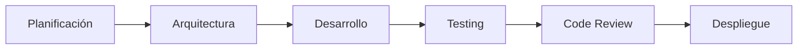

<!-- Sustituye esta ruta solo si tu banner original tiene otro nombre -->

**Ingeniero en Computación e Informática · Licenciado · Full Stack Developer**

[GitHub](https://github.com/koyarxs) &nbsp; · &nbsp; [FlyMaster](https://flymaster.cl) &nbsp; · &nbsp; **Valparaíso, Chile**

## 01 / Sobre mí

Ingeniero en Computación e Informática, titulado de la **Universidad Andrés Bello**, con formación técnica previa en AIEP y **4 años de experiencia en soporte TI N1/N2**. Desarrollo aplicaciones Full Stack y profundizo en arquitectura de software, DevOps, ciberseguridad y desarrollo móvil.

Soy fundador de **YB Veltrix Solutions**, iniciativa de soluciones digitales cuyo primer proyecto comercial es **FlyMaster**.

| Área | Enfoque |
|:--|:--|
| Desarrollo | React, Next.js, TypeScript, Node.js y NestJS |
| Ingeniería | APIs, bases de datos, arquitectura y calidad |
| Infraestructura | Docker, Linux y automatización |
| Aprendizaje | Cloud, Kubernetes, seguridad y React Native |

## 02 / Mi ecosistema tecnológico

Los iconos de esta sección están **guardados dentro del repositorio**, no alojados en servicios de insignias. Algunas áreas corresponden a mi ruta de aprendizaje y no representan dominio avanzado.

### Frontend

<table>
<tr>
<td align="center" width="25%"> <b>HTML5</b></td>
<td align="center" width="25%"> <b>CSS3</b></td>
<td align="center" width="25%"> <b>JavaScript</b></td>
<td align="center" width="25%"> <b>TypeScript</b></td>
</tr>
<tr>
<td align="center" width="25%"> <b>React</b></td>
<td align="center" width="25%"> <b>Next.js</b></td>
<td align="center" width="25%"> <b>Tailwind</b></td>
<td align="center" width="25%"> <b>Vite</b></td>
</tr>
</table>

### Backend y APIs

<table>
<tr>
<td align="center" width="25%"> <b>Node.js</b></td>
<td align="center" width="25%"> <b>NestJS</b></td>
<td align="center" width="25%"> <b>Express</b></td>
<td align="center" width="25%"> <b>OpenAPI</b></td>
</tr>
</table>

### Bases de datos

<table>
<tr>
<td align="center" width="25%"> <b>PostgreSQL</b></td>
<td align="center" width="25%"> <b>MongoDB</b></td>
<td align="center" width="25%"> <b>Prisma</b></td>
</tr>
</table>

### Mobile

<table>
<tr>
<td align="center" width="25%"> <b>React Native</b></td>
</tr>
</table>

### Testing y calidad

<table>
<tr>
<td align="center" width="25%"> <b>Jest</b></td>
<td align="center" width="25%"> <b>Vitest</b></td>
<td align="center" width="25%"> <b>Selenium</b></td>
<td align="center" width="25%"> <b>ESLint</b></td>
</tr>
<tr>
<td align="center" width="25%"> <b>Prettier</b></td>
<td align="center" width="25%"> <b>SonarQube</b></td>
<td align="center" width="25%"> <b>Oxlint</b></td>
</tr>
</table>

### DevOps e infraestructura

<table>
<tr>
<td align="center" width="25%"> <b>Docker</b></td>
<td align="center" width="25%"> <b>Git</b></td>
<td align="center" width="25%"> <b>GitHub</b></td>
<td align="center" width="25%"> <b>GitHub Actions</b></td>
</tr>
<tr>
<td align="center" width="25%"> <b>Kubernetes</b></td>
<td align="center" width="25%"> <b>Linux</b></td>
</tr>
</table>

### Cloud

<table>
<tr>
<td align="center" width="25%"> <b>AWS</b></td>
<td align="center" width="25%"> <b>Azure</b></td>
<td align="center" width="25%"> <b>Cloudflare</b></td>
</tr>
</table>

### Ciberseguridad

<table>
<tr>
<td align="center" width="25%"> <b>OWASP</b></td>
<td align="center" width="25%"> <b>Kali Linux</b></td>
<td align="center" width="25%"> <b>JWT</b></td>
</tr>
</table>

### Herramientas

<table>
<tr>
<td align="center" width="25%"> <b>VS Code</b></td>
<td align="center" width="25%"> <b>Postman</b></td>
<td align="center" width="25%"> <b>Jira</b></td>
<td align="center" width="25%"> <b>pgAdmin</b></td>
</tr>
</table>

### Arquitectura, analítica y prácticas

| Especialidad | Tecnologías y prácticas |
|:--|:--|
| Arquitectura | Clean Code, SOLID, UML, arquitectura hexagonal, microservicios |
| Seguridad | OWASP Top 10, JWT, controles de acceso, desarrollo seguro |
| Analytics y SEO | Google Analytics 4, SEO técnico, Lighthouse, Core Web Vitals |
| Gestión | Scrum, Jira, Git, Pull Requests, Conventional Commits |
| Herramientas | VS Code, Postman, pgAdmin, Docker Compose |

## 03 / YB Veltrix Solutions

**Desarrollo de soluciones digitales para empresas y emprendimientos.** Mi iniciativa reúne desarrollo web, aplicaciones Full Stack, APIs, UI/UX y optimización web.

### Primer proyecto comercial: FlyMaster

**[↗ Ver sitio publicado](https://flymaster.cl)** · **[↗ Ver repositorio](https://github.com/koyarxs/Project-03-FlyMaster-Octubre-2026)**

| Componente | Tecnologías |
|:--|:--|
| Frontend | Next.js, React, TypeScript |
| Backend | NestJS |
| Datos | PostgreSQL |
| Infraestructura | Docker Compose |
| Enfoque | Sitio corporativo, diseño responsive, UI/UX |

## 04 / Proyectos destacados

| Proyecto | Descripción | Acceso |
|:--|:--|:--|
| **FlyMaster** | Plataforma web empresarial para servicios con drones; primer proyecto comercial | [Sitio](https://flymaster.cl) · [Código](https://github.com/koyarxs/Project-03-FlyMaster-Octubre-2026) |
| **FraudShield** | Sistema de clasificación de riesgo financiero; 32 pruebas unitarias y 7 E2E superadas | [Código](https://github.com/koyarxs/Project-02-Fraudshield-2026) |
| **Pawly** | Plataforma Full Stack en desarrollo, organizada con Scrum y Jira | [Código](https://github.com/koyarxs/Project-03-Pawly) |
| **CV Web** | Currículum digital responsive con estructura orientada a ATS | [Código](https://github.com/koyarxs/Proyecto-04-CV-Yerko-Barrera-Septiembre-2026) |

## 05 / Flujo de desarrollo

## 06 / Formación y experiencia

| Formación / experiencia | Detalle |
|:--|:--|
| Ingeniería en Computación e Informática | Universidad Andrés Bello, titulado |
| Grado académico | Licenciado |
| Técnico Programador Computacional | AIEP |
| Experiencia TI | 4 años en soporte N1/N2, sistemas, redes, Microsoft 365 y Active Directory |

## 07 / Próximos desafíos

**Full Stack · React Native · OWASP · CI/CD · Kubernetes · AWS / Azure · Cisco CyberOps**

### ¿Construimos algo interesante?

**Yerko Barrera — Ingeniería de Software**

**YB Veltrix Solutions**

[GitHub](https://github.com/koyarxs) · [FlyMaster](https://flymaster.cl)

*Aprender · Construir · Mejorar*

