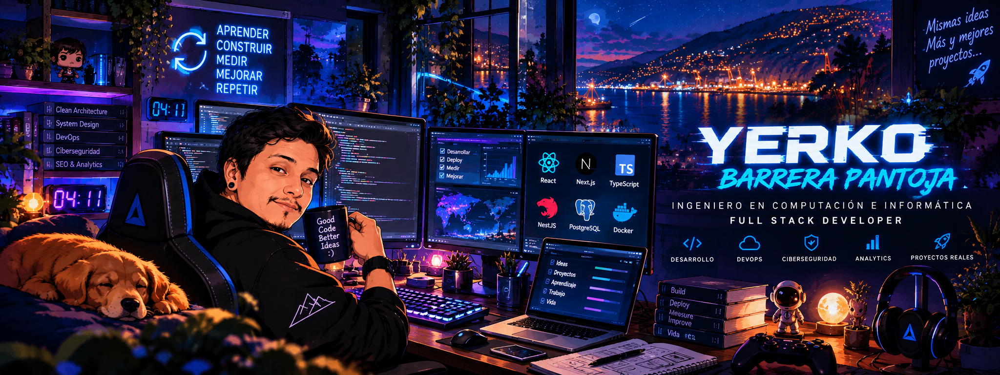
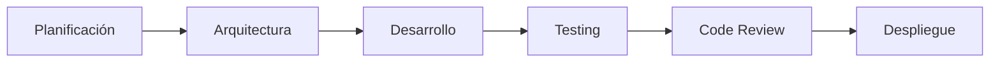

<!-- Conserva tu banner original: ajusta la ruta si tiene otro nombre -->

# Yerko Barrera P.
**Ingeniero en Computación e Informática · Full Stack Developer**

[GitHub](https://github.com/koyarxs) · Valparaíso, Chile

> **Nota:** La animación de escritura depende de un servicio externo; el resto de las franjas e iconos están incluidos localmente.

## 01 · Perfil profesional

Ingeniero en Computación e Informática, Licenciado por la Universidad Andrés Bello y Técnico Programador Computacional de AIEP. Tengo cuatro años de experiencia en soporte TI N1/N2 y desarrollo proyectos Full Stack con interés en arquitectura, DevOps, seguridad y desarrollo móvil.

| Área | Enfoque |
|:--|:--|
| Ingeniería | Arquitectura, SOLID, Clean Code y APIs |
| Desarrollo | React, Next.js, TypeScript, NestJS y bases de datos |
| Infraestructura | Docker, Linux, Git y CI/CD |
| Metodología | Scrum, Jira, ramas de trabajo y Pull Requests |

### Frontend

**HTML5 · CSS3 · JavaScript · TypeScript · React · Next.js · Tailwind · Vite**

### Backend

**Node.js · NestJS · Express · Swagger**

### Datos

**PostgreSQL · MongoDB · Prisma**

### Mobile

**React Native**

### Testing

**Jest · Vitest · Selenium · ESLint · Oxlint · Prettier · SonarQube**

### DevOps

**Docker · Git · GitHub · Actions · Kubernetes · Linux**

### Cloud

**AWS · Azure · Cloudflare**

### Herramientas

**VS Code · Postman · pgAdmin · Jira · Windows**

### Seguridad, arquitectura y analítica

| Especialidad | Tecnologías / conceptos |
|:--|:--|
| Ciberseguridad | OWASP Top 10, JWT, seguridad de APIs, Kali Linux, Cisco CyberOps (en formación) |
| Arquitectura | Clean Code, SOLID, UML, arquitectura hexagonal, microservicios |
| Analytics y SEO | Google Analytics 4, SEO técnico, Lighthouse, Core Web Vitals |
| Desarrollo móvil | React Native (en aprendizaje) |
| Cloud y orquestación | AWS, Azure, Cloudflare, Kubernetes (en profundización) |

## 02 · YB Veltrix Solutions

**Mi iniciativa de desarrollo de software**, orientada a sitios web empresariales, aplicaciones Full Stack, APIs, experiencia de usuario y soluciones digitales.

**Primer proyecto comercial: [FlyMaster](https://flymaster.cl)**, sitio corporativo de una empresa de servicios con drones.

## 03 · Proyectos

### FlyMaster · Primer proyecto comercial

| Área | Tecnologías / trabajo |
|:--|:--|
| Frontend | Next.js, React, TypeScript |
| Backend | NestJS |
| Datos e infraestructura | PostgreSQL, Docker Compose |
| Diseño | UI/UX, responsive, presentación de servicios |

[↗ Sitio web](https://flymaster.cl) · [⌘ Repositorio](https://github.com/koyarxs/Project-03-FlyMaster-Octubre-2026)

### FraudShield · Riesgo financiero

| Área | Tecnologías / resultados |
|:--|:--|
| Full Stack | Next.js, TypeScript, NestJS |
| Datos | PostgreSQL, Prisma |
| Calidad | 32 pruebas unitarias y 7 E2E superadas |
| Función | Procesamiento por lotes, riesgo bajo/medio/alto, auditoría |

[⌘ Repositorio](https://github.com/koyarxs/Project-02-Fraudshield-2026)

### Pawly · Plataforma Full Stack en desarrollo

Next.js, TypeScript, Tailwind CSS, Scrum, Jira, Git y Pull Requests.

[⌘ Repositorio](https://github.com/koyarxs/Project-03-Pawly)

### CV Web · Presentación profesional

HTML, CSS y JavaScript; estructura semántica, diseño responsive y enfoque ATS.

[⌘ Repositorio](https://github.com/koyarxs/Proyecto-04-CV-Yerko-Barrera-Septiembre-2026)

## 04 · Flujo de trabajo

## 05 · Actividad y estadísticas

[↗ Contribuciones](https://github.com/koyarxs) · [↗ Repositorios](https://github.com/koyarxs?tab=repositories)

<!-- Opcional: para estadísticas gráficas estables, generar SVG con GitHub Actions y alojarlos en assets. -->

## 06 · Formación y proyección

| Formación | Institución |
|:--|:--|
| Ingeniería en Computación e Informática y Licenciatura | Universidad Andrés Bello |
| Técnico Programador Computacional | AIEP |

**En desarrollo profesional:** arquitectura de microservicios, Kubernetes, CI/CD, AWS, Azure, OWASP, Cisco CyberOps, React Native e inglés técnico.

## 07 · Contacto

**¿Tienes un proyecto o una oportunidad de colaboración?**

[GitHub](https://github.com/koyarxs) · [FlyMaster](https://flymaster.cl)

**Yerko Barrera · YB Veltrix Solutions**

